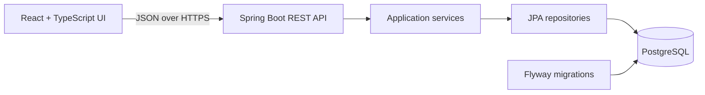

# Architecture

## Approach

Build a modular monolith: a React and TypeScript single-page application calls a Spring Boot REST API backed by PostgreSQL. This is the smallest architecture that satisfies the end-to-end assessment while keeping business rules, transactions, and reporting queries in one deployable backend.



Microservices, asynchronous messaging, Redis, and a separate reporting store are deliberately excluded. They add operational and consistency costs without helping a 10,000-employee workload.

## Backend boundaries

Organize code by business capability rather than by a single global controller/service/repository layer:

```text
com.acme.salary_management
├── employee
├── salary
├── reporting
└── shared
```

Controllers own HTTP concerns and map request/response DTOs. Application services enforce business rules and transaction boundaries. Repositories own persistence queries. JPA entities are not exposed directly from the API.

Salary revisions are append-only, and current salary is derived from the latest effective revision. A salary change locks or conditionally updates the employee version and inserts its revision in one transaction so concurrent requests cannot silently overwrite one another.

## Initial API surface

| Method and path | Responsibility |
| --- | --- |
| `GET /api/employees` | Search, filter, sort, and paginate employees |
| `GET /api/employees/{id}` | Return employee details and current salary |
| `GET /api/employees/{id}/salary-revisions` | Return salary history newest-effective-first |
| `POST /api/employees/{id}/salary-revisions` | Validate and append a salary revision |
| `GET /api/reports/compensation` | Return filtered summaries grouped by currency |
| `GET /api/reference-data` | Return available filter values |

Invalid requests use consistent problem-detail responses. Pagination has a server-enforced maximum size. API responses use decimal numbers for salary amounts and ISO-formatted dates.

## Frontend boundaries

The initial UI has three routes: employee search, employee details/history, and compensation reporting. A typed API client centralizes network behavior. Feature components own their forms and display state, while shared components provide layout, loading, empty, and error states.

## Testing strategy

- Plain unit tests cover salary rules, current-salary selection, seed generation, and report calculations.
- Spring MVC slice tests cover request validation, response contracts, and error mapping.
- PostgreSQL integration tests cover migrations, constraints, repository queries, and transaction behavior. Testcontainers is preferred so tests exercise the production database engine.
- Frontend component tests cover search, validation, error handling, and salary-update interactions.
- A small end-to-end smoke suite covers the critical HR workflow after the individual layers are stable.

Every test dataset uses fixed values, dates, clocks, and random seeds. Tests must not depend on execution order or external services.

## Performance and operations

Server-side pagination prevents loading 10,000 employees into the browser. Database indexes support employee filters and latest-revision lookups. Reports aggregate in PostgreSQL across all matching records and group by currency. Query plans and seed duration will be measured before adding caching or denormalized state.

Configuration and secrets come from environment variables. Flyway applies schema changes during deployment. Health checks, structured application logs, CI checks, and production deployment configuration will be added in later phases.
