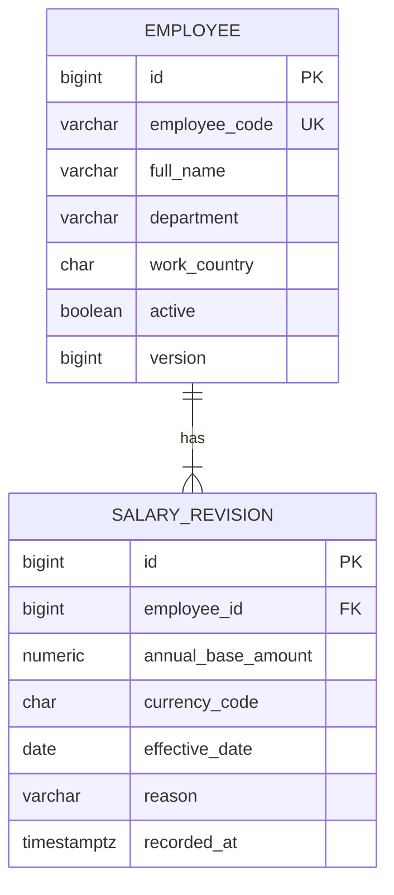

# Proposed Salary Management Data Model

## Status and scope

The product scope and business rules in `requirements.md` are the working requirements for the assessment. PostgreSQL and the schema below are explicit project decisions made in the absence of further clarification from the hiring team.

The model is intentionally limited to employees and salary revisions and is suitable for approximately 10,000 employees. Schema changes will be versioned with Flyway rather than generated automatically by Hibernate.

## Employee

| Field | Proposed PostgreSQL type | Rules |
| --- | --- | --- |
| `id` | `bigint generated by default as identity` | Primary key; required; internal only |
| `employee_code` | `varchar(50)` | Required; unique; stable business identifier |
| `full_name` | `varchar(200)` | Required; non-blank |
| `department` | `varchar(100)` | Required; non-blank |
| `work_country` | `char(2)` | Required; proposed ISO 3166-1 alpha-2 code |
| `active` | `boolean` | Required; active/inactive status |
| `version` | `bigint` | Required; starts at zero; optimistic concurrency token |

`department` and `work_country` remain fields on the employee rather than separate lookup tables. This keeps the initial model small; controlled vocabularies can be introduced later only if requirements justify them.

## Salary revision

| Field | Proposed PostgreSQL type | Rules |
| --- | --- | --- |
| `id` | `bigint generated by default as identity` | Primary key; required; internal only |
| `employee_id` | `bigint` | Required; foreign key to `employee(id)` |
| `annual_base_amount` | `numeric(19,4)` | Required; must be greater than zero |
| `currency_code` | `char(3)` | Required; uppercase currency code; proposed ISO 4217 format |
| `effective_date` | `date` | Required; date on which the salary applies |
| `reason` | `varchar(500)` | Required; non-blank |
| `recorded_at` | `timestamp with time zone` | Required; assigned when the revision is persisted |

Money must use an exact decimal type such as PostgreSQL `numeric`; application code should use `BigDecimal`. `float` and `double` are unsuitable because their binary representation can introduce rounding errors. The proposed scale of four accommodates currencies with differing minor-unit precision, but supported currencies and final precision remain review items.

## Relationship and salary lifecycle

An employee has one or more salary revisions, and each salary revision belongs to exactly one employee. A revision is append-only: changing salary creates a new row rather than updating or deleting an earlier revision.

The initial salary is the employee's first salary revision. For seeded employees, the employee and initial revision should be inserted in one transaction. If interactive employee creation becomes in scope, it should use the same rule. The database foreign key ensures that a revision cannot exist without an employee; requiring every employee to have an initial revision is a transactional application rule because a simple foreign key cannot enforce the reverse direction.

Current salary is derived from the employee's revision having the greatest `effective_date`. Because this proposal permits at most one revision per employee per effective date, the result is unambiguous. History is returned in descending effective-date order, with `recorded_at` available to show when each record was entered.

### Store current salary or derive it?

- **Store it on `employee`:** reads and reports can be simpler, but the same salary is duplicated, every write must keep two representations consistent, and backdated revisions complicate synchronization.
- **Derive it from revisions:** preserves one source of truth and makes history and backdated entries safer, at the cost of a small indexed lookup or join.

Recommendation: derive current salary from `salary_revision`. At this scale, an index on `(employee_id, effective_date desc)` makes the lookup practical and avoids premature denormalization. A cached or materialized current value should be considered only if measured performance later requires it.

## Proposed constraints and indexes

- Primary keys on both `id` columns.
- Unique constraint on `employee.employee_code` to support deterministic, duplicate-safe seeding.
- Foreign key from `salary_revision.employee_id` to `employee.id`, with deletion restricted rather than cascading away salary history.
- Check constraints for `annual_base_amount > 0`, non-blank employee code/name/department/reason, uppercase three-character currency format, and uppercase two-character country format.
- Unique constraint on `(employee_id, effective_date)` to prevent ambiguous same-day revisions.
- Index on `salary_revision (employee_id, effective_date desc)` for current-salary lookup and history. The unique constraint may satisfy this access path depending on its index ordering; avoid creating a redundant index after checking the query plan.
- Indexes supporting employee filters and reports, initially `(work_country)` and `(department)`. The low-cardinality `active` field should be included in a composite index only if measured query patterns justify it.

Reports must group salary amounts by `currency_code`; work country must never be used to infer or overwrite currency.

## Date and concurrency rules

- Reject `effective_date` values after the current date in UTC.
- Permit an earlier effective date as a backdated historical revision. It does not become current when a later effective revision already exists.
- Reject a second revision for the same employee and effective date. Replacing or correcting an erroneous revision is not defined by the current requirements and needs an explicit audit policy before implementation.
- Treat revisions as append-only. Do not update an existing revision as the normal salary-change operation.
- Require the client to submit the employee `version` observed when starting an update. In one transaction, atomically increment the version only if it still matches, then insert the revision. A version mismatch returns a conflict instead of silently accepting an update based on stale information. The unique same-day constraint remains a final database safeguard.

`effective_date` and `recorded_at` represent different facts. The effective date is the business date on which compensation applies; the recorded-at timestamp is the audit time when the system stored the revision. A backdated revision can therefore have an earlier effective date but a later recorded-at timestamp.

## Entity-relationship diagram

## Decisions and deferred questions

The initial release uses PostgreSQL, ISO-style uppercase country and currency codes, `numeric(19,4)`, UTC, append-only backdated revisions, and derived current salary. Employee lifecycle operations and correction of erroneous historical revisions are deliberately deferred. These decisions should be revisited if the hiring team supplies conflicting requirements or measured performance shows that the derived-current-salary query needs optimization.

## Requirements alignment

PostgreSQL resolves the assessment's open database choice. Allowing backdated revisions and rejecting same-day duplicates make revision ordering deterministic. Country and currency remain independent; the model does not automatically map one to the other.
